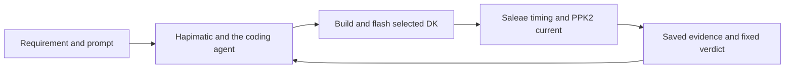

# CRANIUM on nRF7002 DK

[](https://github.com/adamshal/cranium-closed-loop/actions/workflows/host-tests.yml)

Zephyr/NCS firmware and a closed-loop AI development bench for CRANIUM's DJ
telemetry companion. **The nRF5340 receives song/session events over UART and
forwards them over BLE.** The Raspberry Pi retains Mixxx and audio. The AI can
build, flash, measure and revise the MCU firmware against fixed tests.

Board target: `nrf7002dk/nrf5340/cpuapp`, including its Bluetooth network core.
This follows the [professor's example](https://github.com/ese5180/hapimatic-test-v1)
for repository layout, build instructions, peripheral documentation and PPK2
measurement workflow, adapted to our Nordic hardware.

<!-- STATUS:BEGIN -->

**Software builds/tests pass; physical validation is pending.** No physical
flash, UART timing pass, BLE delivery or before/after power saving is claimed.
The badge reports host tests only.

<!-- STATUS:END -->

## Layout

```text
app/
  west.yml                         # NCS v3.4.0 pinned to an exact commit
  CMakeLists.txt                   # app and profile-header generation
  prj.conf                         # UART0, BLE NUS, bounded resources
  boards/nrf7002dk_nrf5340_cpuapp.overlay
  src/main.c                       # UART IRQ, queues, ACKs, BLE transport
  src/protocol.c                   # CRC, frame bounds, sequence validation
  src/profile.h.in                 # CMake template; no private header needed
  profiles/{baseline,optimized}.json
  sysbuild.conf                    # application + HCI IPC network cores
  sysbuild/ipc_radio.conf           # unused network serial/logging disabled
GeneratedFiles/ppk2/ppk2.py          # measure/hold utility like the example
workbench/                         # builds, instruments, verdicts, MCP jobs
prompts/                           # requirements-based AI prompts
requirements.json                  # numerical tests set before changes
tools/                             # manifest check, exports, radio/journal
tests/                            # host suite, including actual C parser
evidence/                         # publishable software validation
.github/workflows/host-tests.yml    # host CI; no physical HIL claim
deps/ .west/ .venv/ build/          # fetched/generated, Git-ignored
captures/ .state/ bench.local.json  # private local bench data, Git-ignored
```

The SDK supplies UART/GPIO/Bluetooth drivers. Our custom peripheral logic is
in `app/src/`; the example's ADXL343 accelerometer is not part of this DJ build.

## Daily use

After setup, from the repository root:

```sh
./bench test
./bench build --profile baseline
./bench build --profile optimized
./bench doctor
./bench measure --seconds 20   # PPK2 only; no analyzer, does not flash
./bench hold --seconds 120     # keep the checked PPK2 path on temporarily
./bench run                   # full build/flash/Saleae/PPK2 experiment
./bench latest
```

On the configured Mac, use **Configure Bench.command** once to select the
DK/PPK2 and verify wiring. A missing analyzer does not prevent configuring
standalone PPK2 measurements. **Start AI Loop.command** starts a requirements-
seeded Hapimatic run of the coding agent set in `bench.local.json` when the
full rig is ready. **Open Workbench.command** opens Hapimatic without starting
the agent.

The full experiment enables the checked measurement path before SWD flashing,
programs both cores using the selected J-Link ID, then measures. Do not run a
separate hold process at the same time as `./bench run`.

## Fresh setup

The installed bench is qualified on Apple Silicon macOS with **NCS 3.4.0**,
its Nordic toolchain, Python 3.11+ and a signed-in coding-agent CLI that
Hapimatic supports: set `agent` (Hapimatic's name for it), `agent_cli` if it is
not on PATH, and `agent_config` (its TOML file of MCP servers) in
`bench.local.json`. Install the
SDK/toolchain with Nordic's normal tools before running the automated bench.

```sh
git clone https://github.com/adamshal/cranium-closed-loop.git
cd cranium-closed-loop
./setup.sh
./bench test
```

`setup.sh` restores pinned Python adapters, official Hapimatic and Logic 2,
and this project's limited MCP adapter. It does not flash or enable power.
`CRANIUM_SDK` selects an NCS source root containing `nrf/` and `zephyr/`;
`CRANIUM_TOOLCHAIN` selects another installed Nordic toolchain. Existing
standard Mac locations work by default. The wrapper builds in a space-free
cache and copies HEX files/manifests into `build/<profile>/`. The Pi, SD card,
and music USBs are not changed.

### Pinned west workspace

Like the example, `app/west.yml` makes dependencies reproducible. It pins NCS
v3.4.0 to `99553055607b2e9885fbc80ccd11fa9da81c2df0` and imports matching
Zephyr/Nordic modules under `deps/`. These SDK sources are not committed.
We retain NCS's vendor dependencies for its BLE controller and dual-core setup;
the professor's example instead selects STM32 modules.

For a local source workspace instead of an existing SDK source tree, use a
checkout path without spaces and the matching installed Nordic toolchain:

```sh
.venv/bin/python -m pip install -r requirements-build.txt
source .venv/bin/activate
west init -l app
west update --narrow -o=--depth=1
west packages pip --install
west zephyr-export
./bench build --profile optimized    # detects deps/ as the SDK
```

With the toolchain environment active, direct west builds also work:

```sh
west build --sysbuild -b nrf7002dk/nrf5340/cpuapp -d build/direct app -- \
  -Dapp_CRANIUM_PROFILE=optimized
west flash -d build/direct --dev-id YOUR_JLINK_SERIAL
```

Keep the checked MCU rail powered for direct flashing, for example with the
bounded PPK2 hold helper in another terminal. The automated experiment manages
this ordering itself. Neither workflow uses `recover` or erase-all. CMake
creates `profile.h` from the selected JSON; no private generated header is
required. `tools/check-west-manifest.py` checks recursive imports offline
against an installed SDK without downloading or modifying dependencies.

## UART/BLE peripheral

| Connection/output | nRF7002 DK / behavior |
| --- | --- |
| Debug/programming | DK debug/J-Link USB; selected numeric serial |
| UART ingress / Saleae channel 0 | P0.22, UART RX |
| UART ACK / Saleae channel 1 | P0.20, UART TX |
| Logic ground | DK GND |
| UART format | 115200 baud, 8N1; no hardware flow control |
| BLE | CRANIUM-Link; Nordic UART Service notifications |
| Status LED | LED0, P1.06; disabled in the idle candidate |

The Mac's debug VCOM supplies test packets, so the Pi is not required for this
bench. Locate physical pins from the silkscreen/board drawings. Signals follow
the DK's actual rail voltage, which may be 1.8 V; do not assume 3.3 V.

`C1:<uint32 sequence>:<UTF-8 byte length>:<JSON payload>*<4 hex CRC digits>\n`

CRC-16/CCITT-FALSE starts at 0xFFFF over the header/payload. Payloads are bounded
to 480 bytes. The MCU rejects corruption and duplicate/stale sequences, supports
uint32 wrap and uses bounded queues. Its reply is
`ACK:<sequence>:OK:<radio_queued 0 or 1>\n`, or CRC/DUP/FRAME on rejected input.
Oversized lines are discarded. Advance the sequence or restart development
firmware before replaying an older stream.

**UART receipt is not proof of BLE delivery.** Radio forwarding is best-effort:
disconnects, full queues and exhausted retries can drop events. The upstream
journal remains the durable store. Notifications require L2 encryption with
Just Works pairing; persistent bonding/MITM authentication are future work.
This does not replace the separate authenticated Afterset relay.

`tools/relay-journal.py` forwards an existing NDJSON journal, rejecting oversized
payloads. This repository does not install a live Mixxx observer/Pi journal
connection. `tools/radio-smoke.py` separately verifies two ordered events over
actual BLE; that physical test remains pending.

## Power

The initial reference and candidate are AI-authored profiles, not measured
savings. Both must retain the UART feature.

| Profile/step | Average current | Change |
| --- | --- | --- |
| Baseline | Pending PPK2 capture | 100 ms advertising, LED/50 ms heartbeat |
| Optimized candidate | Pending PPK2 capture | 1000 ms advertising, LED off, event-driven wait |
| Validated result | Pending real experiment | Target: at least 25% lower median mean current |

The target was chosen before testing. The professor's STM32 figures are not
CRANIUM measurements. STM32 Range 2, Stop registers, Nucleo JP1 wiring and
that board's clock configuration must not be copied onto the nRF5340.

### Standalone PPK2 measure/hold

The example's utility entry-point pattern is available with our Nordic wiring
and checked device configuration:

```sh
.venv/bin/python GeneratedFiles/ppk2/ppk2.py measure 20
.venv/bin/python GeneratedFiles/ppk2/ppk2.py hold 120
```

These commands **need no logic analyzer and do not flash firmware**. `measure`
saves raw PPK2 bytes, calibration, CSV, sample coverage and mean/peak figures
under `captures/ppk2-measure-<UTC>/`. The existing firmware identity is explicitly
unverified, so one reading is not a validated before/after comparison. `hold`
keeps the checked measurement path connected for the requested time and releases
it on Ctrl+C/error. Holds have a 15-minute cap; measures are limited to 1-60
seconds. Neither command marks the overall HIL requirement passed.

The adapter waits for quiet USB input before calibration, refuses missing or
uncalibrated metadata, handles partial four-byte sample packets, and releases
the PPK2 path in cleanup. Select the PPK2 data interface rather than its other
USB interface; no professor-specific port or serial number is hardcoded.
The 100 kS/s coverage gate remains 90%, rather than silently accepting dropped
data. CSV times are labelled nominal; raw bytes/chunk wall times are retained.

### Nordic measurement wiring

Measure **nRF5340 plus IOVDD**, not only the nRF7002 Wi-Fi VBAT rail. Nordic's
routed **P22 VDD_MEAS** arrangement uses **SB16 open / SB17 closed**, with the
P22 measurement jumper removed. Verify the board revision and get lab help
with this one-time preparation if needed.

Default mode is ampere measurement: PPK2 VIN goes to the supply side, VOUT to
the MCU/load side and GND to DK GND. Keep the debugger's own supply outside the
measured rail. Enter the checked voltage (often 1.8 V), not an assumed 3.3 V.
Do not leave a parallel jumper/supply bypassing the meter. Close Power Profiler
before our script owns the PPK2. The board receives power through that path
only while the helper/experiment holds it open. Follow [PHYSICAL-SETUP.md](PHYSICAL-SETUP.md)
and [Nordic's rail guide](https://docs.nordicsemi.com/r/bundle/ug_nrf7002_dk/page/ug/nrf7002_dk/nrf5340_nrf7002_measure_current.html).

## Closed-loop development and pass test



The prompts in `prompts/` specify goals before a change. `AGENTS.md` bounds
edits and prohibits invented results. Seven MCP tools expose fixed build,
test, power, experiment and report operations; long work returns job IDs. The
full loop stops on success, missing hardware, instrument/wiring faults, three
attempts or 40 minutes.

| Acceptance test | Fixed requirement |
| --- | --- |
| Peripheral | 100 UART messages acknowledged; one duplicate and one bad CRC rejected |
| Independent timing | Physical Saleae RX/TX capture; ACK begins within 50 ms, with 20 us stop-bit tolerance |
| Preservation | Baseline and optimized images both pass |
| Power | Three alternating matched pairs, 15 seconds each |
| Settling | Five seconds after flash and traffic |
| Reduction | At least 25% lower median mean current; every pair improves |
| Data quality | At least 90% expected PPK2 samples |
| Conditions | Same checked rail, voltage and rig; BLE clients disconnected |

`./bench run` locks the rig, builds both profiles/cores, checks matching source
hashes and effective compiled settings, then flashes and measures each pair.
Saleae timing comes from physical edges, not USB scheduling timestamps. A
failed candidate triggers a baseline-restore attempt; rollback failures are
reported. Captures retain stimulus, raw wire/current data, calibration, flash
logs, source/image SHA-256s and JSON verdicts. The AI reads the evidence,
revises its own candidate when warranted, retests and commits actual passing
results. Instrument/wiring failures stop the loop instead of hiding a fault.

The manual still calls for Saleae validation. The example's PPK2 utility does
not waive that requirement. Power-only work is useful while the analyzer is
unavailable, but cannot complete the full peripheral checkoff.

## Results and checkoff

Software validation on 2026-11-15: **26 host tests pass**, both dual-core Nordic
profiles build, and the pinned west manifest resolves offline against the
installed SDK. CI runs only host tests. See `evidence/software-validation.json`
and [VALIDATION.md](VALIDATION.md).

<!-- MEASUREMENTS:BEGIN -->

No real CRANIUM board/analyzer/PPK2 experiment has been recorded. Physical UART
timing, BLE delivery and before/after current figures remain pending.

<!-- MEASUREMENTS:END -->

For Venture Manual section 3.7, demonstrate the requirements-based prompt,
flashed peripheral behavior, saved Saleae proof and PPK2 before/after metrics.
Update this README with actual results, then submit its current PDF with the
code in the team's Venture repository. This repository does not claim signed
OTA, cloud fleet management or the rest of the assignment complete. A passing
build or simulated capture is not physical HIL.

At checkoff, explain UART, CRC, sequence checking, BLE forwarding, current
measurement and event-driven waiting. The loop closes when measured feedback
determines the AI's next change or proves the candidate passes.

## Comparison with the professor's guideline

Reference: [ese5180/hapimatic-test-v1 at 1816e0a](https://github.com/ese5180/hapimatic-test-v1/tree/1816e0aa3b9ece1ea5d27044637b7791c739a1d2).

| Example deliverable | CRANIUM counterpart |
| --- | --- |
| app, west manifest, CMake/Kconfig/overlay | Same layout; pinned NCS; Nordic dual-core target |
| ADXL343 driver and wiring | UART CRC/sequence/BLE logic and pin table; SDK drivers reused |
| Daily build/flash and fresh-clone instructions | Wrapper and direct west workflows |
| PPK2 measure and powered hold | Same entry-point pattern; checked Nordic rail/device IDs |
| Power-change table and measured figures | Baseline/candidate table; pending until measured |
| Board caveats | Voltage/P22 domain, two cores, SWD, queue/security limits |

The example is a guideline, not evidence for our board. Public source excludes
local configuration, credentials, private tokens and user music/history. Use
`tools/export-kit.py` for a source/HEX kit and `tools/export-readme.py` for a
README PDF (optional `requirements-docs.txt`).

## Licensing and references

New CRANIUM code is MIT. The SDK/packages retain their licenses. Hapimatic is
downloaded unchanged under AGPL-3.0; its binaries/private state are not committed.
See NOTICE.md and upstream.lock.json for exact versions and attribution.

- [Course closed-loop starter](https://github.com/SolidPD/closed-loop-starter)
- [Open Hapimatic core](https://github.com/SolidPD/hapimatic-core)
- [Saleae capture API](https://docs.saleae.com/automation/api/automation/Capture)
- [PPK2 Python API](https://github.com/IRNAS/ppk2-api-python)
