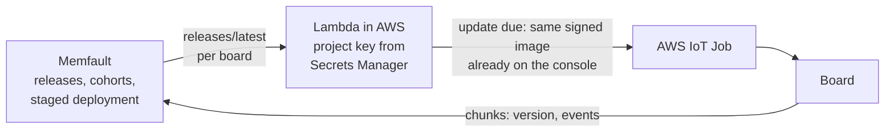

# Updating many boards at once

Two ways to send one release to a whole fleet. The first is built and works today. The second would let Memfault decide
who gets what, while AWS still delivers the image.

## 1. From the console (built)

The console already updates many boards at once ([`fleet.md`](fleet.md), "Groups and rollouts"):

- **One deployment to many boards.** A deployment targets some boards, a group ("lab bench", "demo"), a board type, or
  the whole fleet. It only takes boards that can run the release: the right board type and flash layout, and an older
  version.
- **A staged rollout.** One release goes to a canary board first, then to the rest in stages (1 to 10, from console
  2.8.0). Each stage updates all its boards at once, and the next starts only once it has ended within its failure
  limit, after an optional soak time. It stops by itself when the canary does not confirm, or too many boards of a
  stage fail.
- **A health gate** (from console 2.12.0, on by default for 10 minutes). Before each next stage, the boards updated so
  far must run the release that long with no new Memfault issue and no unexpected reboot (Assert, fault, watchdog).
  Otherwise the rollout stops, naming the board and the issue with a link, and raises an alert. If Memfault cannot be
  read, it waits up to 30 minutes and then stops: it never passes without an answer ([`fleet.md`](fleet.md)).
- **Chosen with help.** The Roll out dialog asks the console for a plan (`GET /api/rollouts/suggest`): the canary, the
  number of stages and their sizes (growing, say 10 % → 30 % → the rest), the soak time and the health gate, each with
  its reason, and
  warnings such as most of the group being offline. Any of it can be changed before starting.
- **Each board is safe on its own.** MCUboot runs the new image on trial and puts the old one back unless the new one
  confirms itself (A/B).

**The steps:**
1. Upload the release on the Firmware page. `scripts/firmware/build.sh` builds the next version, uploads it there and gives
   Memfault its release and symbols.
2. Put the boards in a group, under Fleet, Groups.
3. Start a deployment or a staged rollout to the group, the type, or every board. For a group, look at the suggested
   stages, change them if needed, and start; the rollout's page shows each stage as it goes, and why it stopped if
   it did. Alerts (rules on the Alerts page, [`alerts.md`](alerts.md)) say so by e-mail and on every open page.

Spare releases built ahead with `scripts/firmware/build.sh --no-upload` wait in `binaries/`. Upload one when it's needed:
- `scripts/firmware/upload-to-console.sh binaries/<image>`;
- for Memfault, `memfault --org-token … upload-mcu-symbols` with the build's `zephyr.elf`, kept beside each spare.

A board takes only a release newer than the one it runs, so use the spares in order.

## 2. With Memfault deciding (not built)

Memfault has its own OTA side: **releases**, **cohorts** (named sets of devices) and **staged deployments** (a share of a
cohort at a time, raised by hand or on a schedule). A device asks Memfault whether there is a release for it:

```
GET https://device.memfault.com/api/v0/releases/latest
    ?device_serial=…&hardware_version=nrf7002dk&software_type=app&current_version=1.14.0+0
Memfault-Project-Key: <project key>
→ 204 when it is up to date, else a release with its artifact's URL
```

The nRF Connect SDK can do this on the board (`CONFIG_MEMFAULT_FOTA`). We should not:
- it needs the project key in every image;
- it needs a second TLS connection, which our RAM does not have room for (about 1.5 KB free on 1.14.0);
- it would bypass the console's checks.

**The fitting design asks Memfault from AWS, for each board, and lets AWS deliver as now:**



1. **Cohorts:** put the boards in cohorts in Memfault, e.g. "canary" and "fleet". Upload the same signed image as a
   Memfault release (`tools/memfault_upload.py` already makes the release).
2. **Deployments:** deploy that release in Memfault to a cohort, at 10 %, then 50 %, then 100 %.
3. **Asking:** a function in AWS runs every few minutes, or when a board reports. For each online board, it asks
   Memfault's releases/latest with the board's serial and version, using the project key it already holds.
4. **Delivering:** when Memfault answers with a release, the function matches its version to the release on our
   console and creates the AWS IoT job: the same signed image, the same checks. It never fetches Memfault's own
   artifact.
5. **Showing it:** Memfault shows the rollout's progress from the versions the boards report, which it already
   receives.

**What it would take:**
- the function and its schedule;
- an IAM role able to read the key and create jobs;
- a map from Memfault version to console release;
- a "Managed by Memfault" switch per group, so the console and Memfault never both roll out to a board.

Nothing changes on the board: it already reports its version to Memfault and takes AWS jobs. An estimate: a day of work,
plus tests with a fake Memfault, as for the forwarder.
